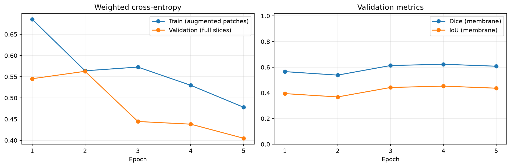
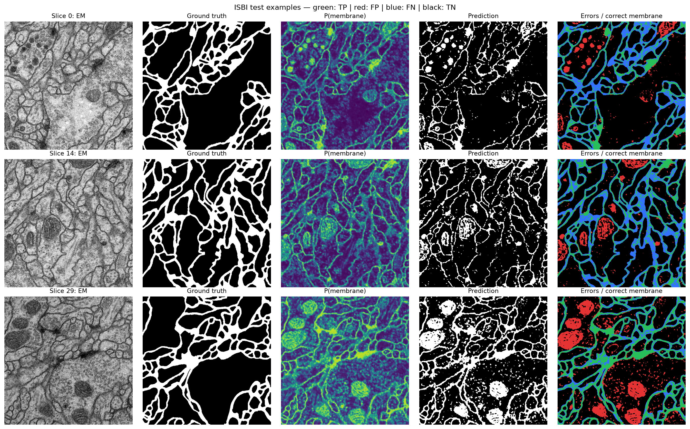
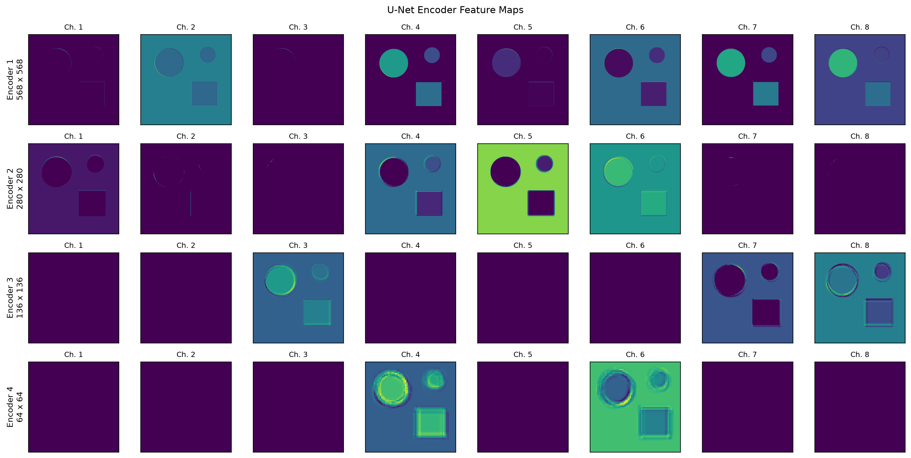
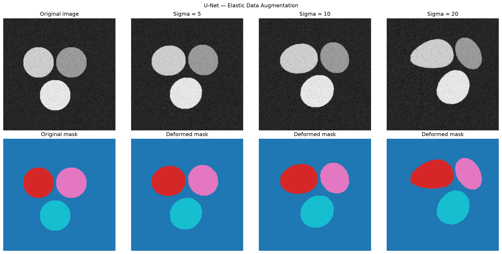

# U-Net — Biomedical Image Segmentation

PyTorch implementation and experimental study of the original
U-Net architecture proposed by Ronneberger, Fischer and Brox (2015).

## Overview

This project explores U-Net for neuronal membrane segmentation
using electron microscopy images from the ISBI 2012 dataset.

The objective is to understand the original scientific paper,
implement the architecture from scratch, and evaluate its
performance under two different training configurations.

## Architecture

- 23 convolutional layers
- Encoder and decoder paths
- Skip connections with center cropping
- Transposed convolutions
- He weight initialization
- Weighted Cross-Entropy Loss
- Elastic data augmentation
- Dropout regularization
- Overlap-tile inference

## Experimental Results

| Metric | 5 Epochs | 20 Epochs |
|---|---:|---:|
| Validation Dice | 62.32% | 74.16% |
| Test Dice | 62.31% | 76.96% |
| Test IoU | 45.25% | 62.54% |
| Mean IoU | 60.19% | 72.90% |
| Pixel Accuracy | 79.37% | 86.91% |

The second experiment increases both the number of epochs
and the number of sampled patches per slice.

## Learning Curves



## Segmentation Results



## Encoder Feature Maps



## Elastic Data Augmentation



## Project Structure

```text
.
├── src/
│   ├── unet.py
│   ├── dataset.py
│   ├── loss.py
│   ├── weight_map.py
│   ├── initialization.py
│   └── augmentation.py
├── notebooks/
│   ├── 01_unet_implementation.ipynb
│   ├── 02_unet_training.ipynb
│   ├── 03_unet_experiments.ipynb
│   └── 04_unet_extended_training.ipynb
├── results/
├── report/
├── requirements.txt
└── README.md
```

## Installation

```bash
git clone https://github.com/Ben10-L/unet-biomedical-segmentation.git

cd unet-biomedical-segmentation

python3.12 -m venv .venv

source .venv/bin/activate

pip install -r requirements.txt
```

## Dataset

Download the ISBI 2012 dataset:

https://imagej.net/events/isbi-2012-segmentation-challenge

Extract the dataset into:

```text
data/ISBI-2012-challenge/
```

The dataset and model checkpoints are not included in the repository.

## Usage

```bash
jupyter notebook
```

Execute the notebooks in numerical order.

## Technologies

- Python 3.12
- PyTorch
- NumPy
- SciPy
- Matplotlib
- Jupyter Notebook
- Apple Silicon MPS

## Limitations

This project is an educational reproduction of U-Net,
not an exact reproduction of the original challenge results.

The experiments use a limited dataset, a single random seed,
smaller training patches and different evaluation metrics.

## Academic Report

[Read the synthesis report (French)](report/Rapport_Synthese_UNet.pdf)

## References

Ronneberger, O., Fischer, P., and Brox, T. (2015).
U-Net: Convolutional Networks for Biomedical Image Segmentation.

https://arxiv.org/abs/1505.04597

## Author

Oussama Beniaich

